# Лабораторная работа №1 — Ansible

## 1. Разработка роли без использования сторонних ролей

В этой лабе я собрал собственную роль `opensearch` для установки OpenSearch и OpenSearch Dashboards 3.8.0. Работал в репозитории IaC, в ветке `lab-1`. Всю логику разделил на отдельные таски: подготовка системы, установка, настройка и проверка сервисов. Использовал встроенные модули Ansible, например `apt`, `template`, `command`, `assert` и `uri`. Сторонние роли не подключал, решил не изобретать велосипед там, где штатные модули и так нормально справляются.

Основной плейбук вызывает мою роль, а сама роль уже выполняет нужные действия на Ubuntu. Так код не превращается в одну огромную простыню и в нём проще ориентироваться. Репозиторий и рабочая ветка показаны на скриншоте 2.

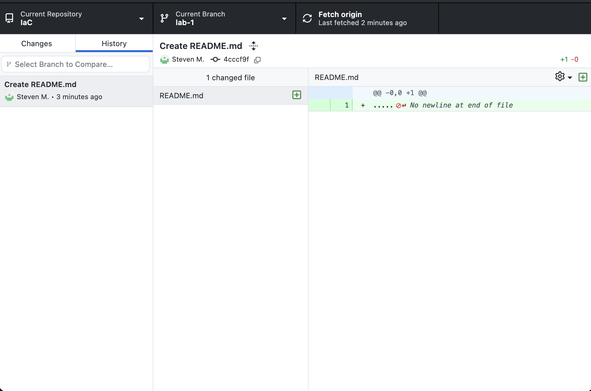

## 2. Установка непосредственно на Linux-машину

Стенд поднял через Multipass. Создал виртуалку `iac-lab1` с Ubuntu 24.04. Выделил два ядра, четыре гига оперативки и двадцать гигов диска. Выполнил `multipass launch 24.04 --name iac-lab1 --cpus 2 --memory 4G --disk 20G`. Потом проверил машину через `multipass list` и `multipass info iac-lab1`. Виртуалка запустилась и получила адрес `192.168.252.2`. Внутри стояла Ubuntu 24.04.5 LTS с архитектурой aarch64 и systemd 255. Создание и проверка ВМ показаны на скриншотах 3 и 4.

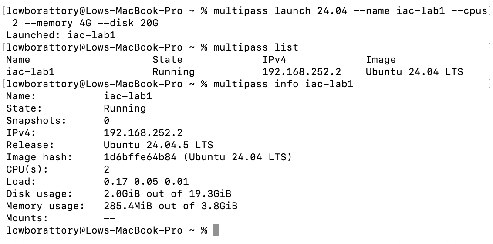

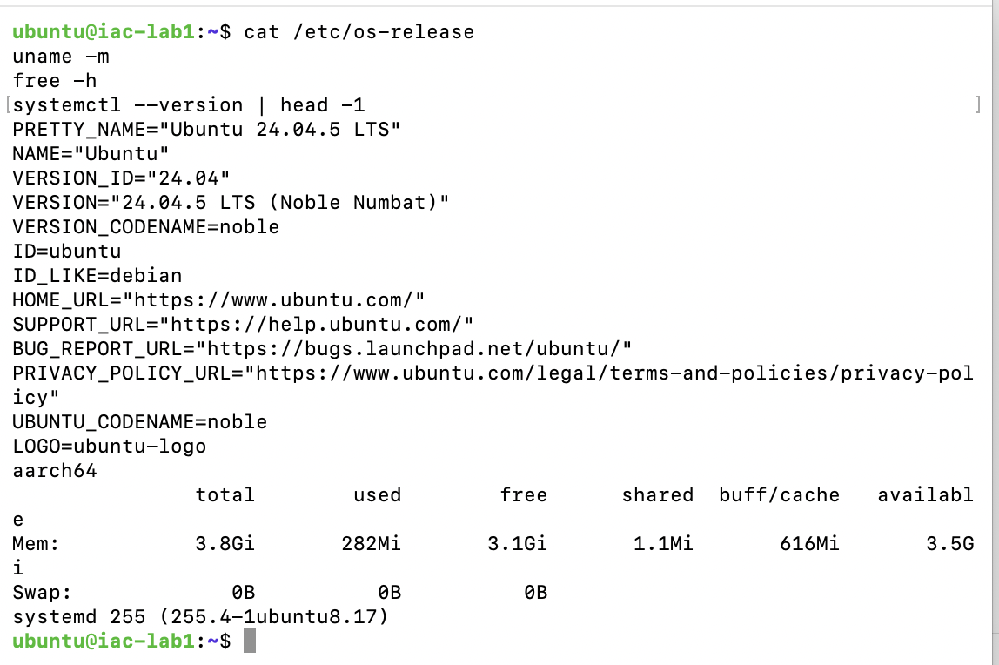

Ansible запускал со своего Mac. Пакеты ставил прямо в Ubuntu через `apt`, без Docker и контейнеров. Сначала проверил SSH-подключение модулем `ping`. Использовал пользователя `ubuntu` и свой SSH-ключ. После настройки inventory выполнил `ansible opensearch -m ping`. Хост `opensearch-node` вернул `pong`. Коннект есть, можно катить дальше. Это видно на скриншотах 5 и 7.

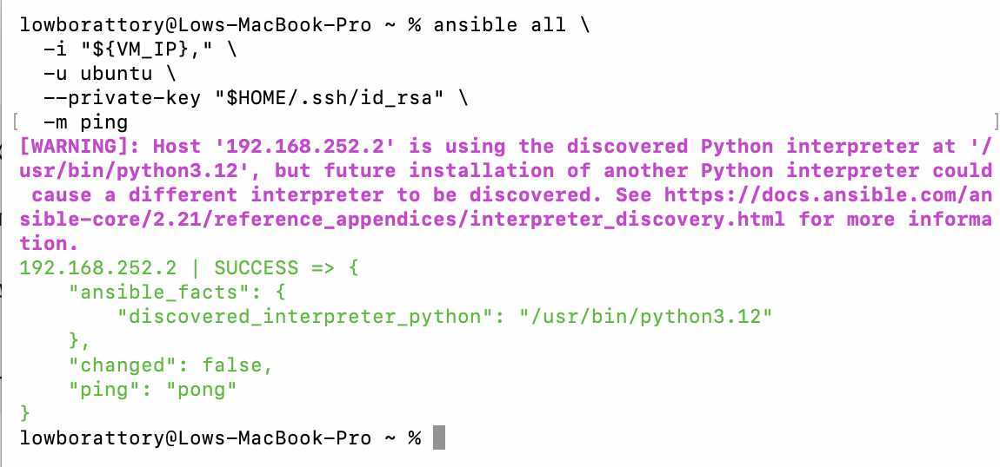

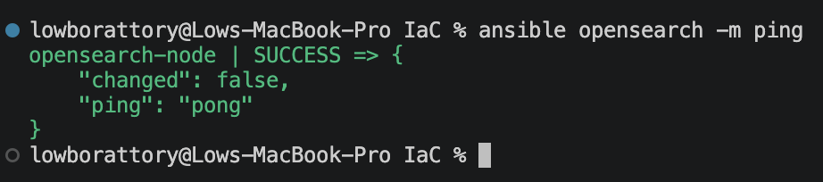

## 3. Стандартные директории роли

Роль разместил в `roles/opensearch`. В `defaults` вынес настройки по умолчанию, в `vars` — названия пакетов и системные пути. В `files` положил файлы пакетных репозиториев, а в `templates` — Jinja2-шаблоны конфигов. Основные задачи находятся в `tasks`. Разбил их по этапам, чтобы потом не искать нужную таску к чёрту на куличики в одном большом YAML-файле.

В `handlers` описал перезапуск сервисов и применение настроек `sysctl`. В `meta` указал информацию о роли, поддерживаемую Ubuntu и пустой список зависимостей, потому что сторонние роли не использую. В `tests` добавил отдельный плейбук для запуска роли. Получилась стандартная структура, где у каждой папки есть конкретное назначение. Структура проекта показана на скриншотах 6 и 9.

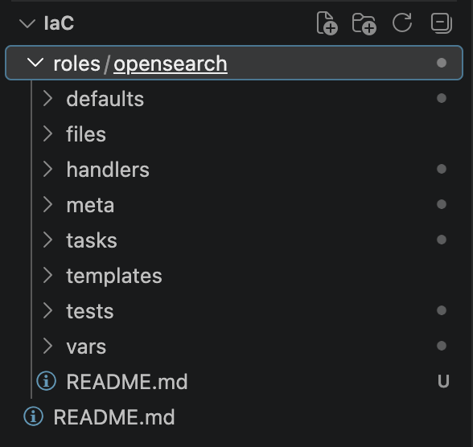

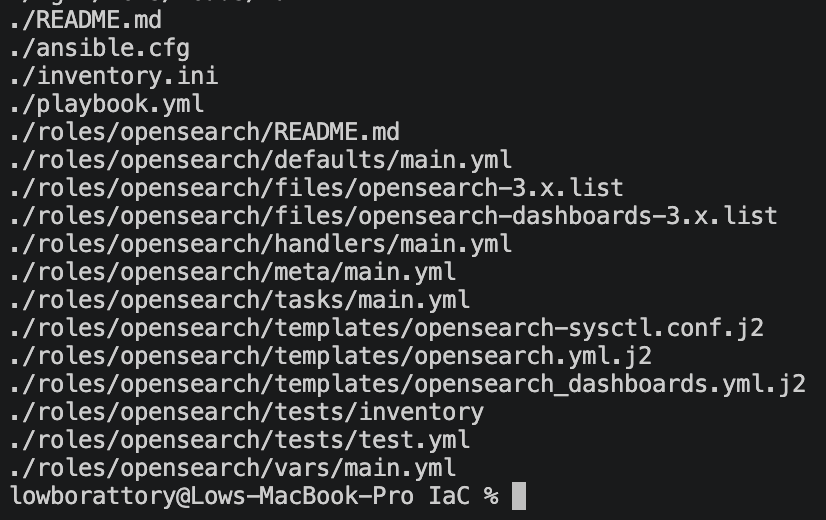

## 4. Установка заданной версии, настройка системы и запуск

Версию OpenSearch зафиксировал на `3.8.0` и передал в задачу установки через `apt`. После установки проверяю версию пакета командой `dpkg-query`, а затем сравниваю результат с нужным значением через `assert`. Если установится не та версия, роль сообщит об ошибке. Также подготовил подключение пакетных репозиториев и настройку `vm.max_map_count` со значением `262144`, которое требуется для нормальной работы OpenSearch. Установка и проверка версии показаны на скриншоте 11.

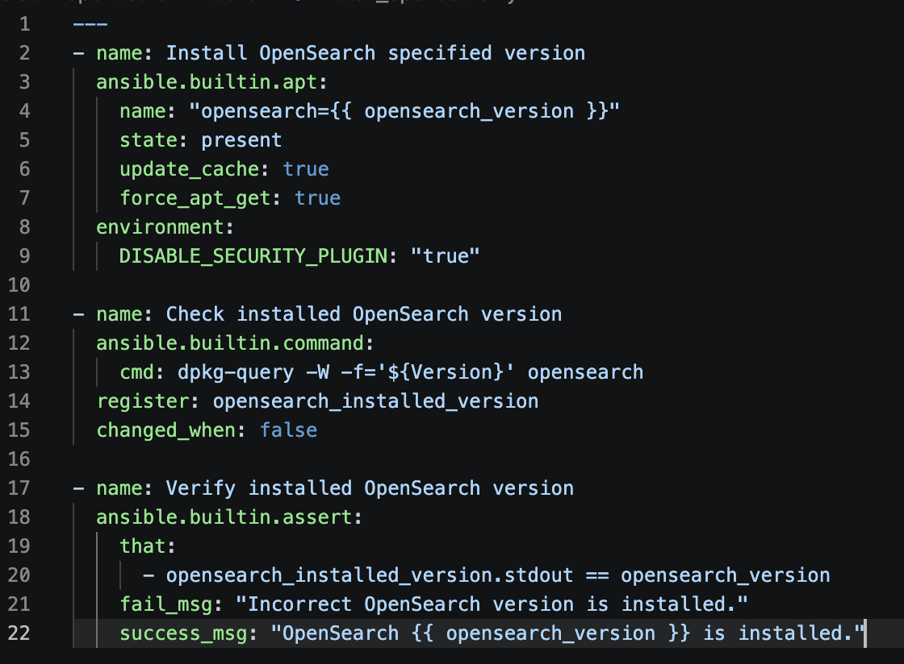

Для OpenSearch выбрал режим `single-node`, потому что в лабе у меня одна виртуалка, а не полноценный кластер из нескольких серверов. Security-плагин отключил в учебной конфигурации. После установки Ansible применяет конфиги и запускает OpenSearch и Dashboards как системные сервисы. В итоге обе программы установлены в версии 3.8.0, запускаются через `systemd` и отвечают на API-запросы.

## 5. Параметризация роли и значения по умолчанию

Основные настройки вынес в `defaults`. Так можно менять стенд без правок тасок и шаблонов. Параметр `opensearch_version` задаёт версию, по умолчанию это `3.8.0`. В `opensearch_cluster_name` указал имя `opensearch-lab`, а `opensearch_node_name` берёт имя хоста из inventory. Фиксированная версия нужна для повторяемого деплоя. Имена можно менять под своё окружение. Для `opensearch_network_host` задал `127.0.0.1`, а для `opensearch_http_port` — `9200`. В таком сетапе API OpenSearch слушает локальный интерфейс виртуалки.

Для `opensearch_dashboards_host` указал `0.0.0.0`, чтобы Dashboards слушал все сетевые интерфейсы ВМ. Порт вынес в `opensearch_dashboards_port` со значением `5601`. В `opensearch_vm_max_map_count` записал `262144`. За ожидание готовности отвечают `opensearch_readiness_retries` и `opensearch_readiness_delay`: двенадцать попыток и пауза пять секунд. Время ожидания можно подстроить под скорость машины, не нужно хардкодить его в каждой проверке. Значения показаны на скриншоте 8.

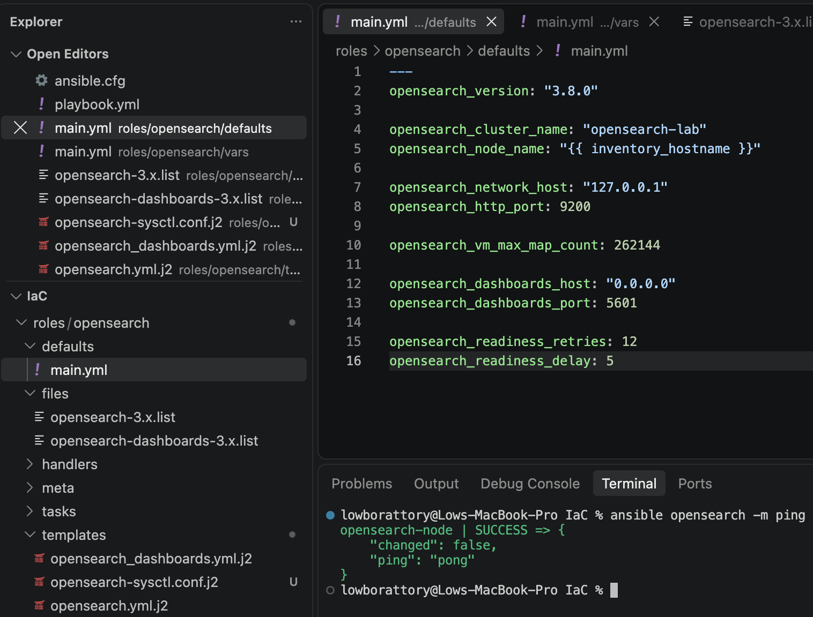

## 6. Конфигурационные файлы через Jinja2

Конфиги оформил через шаблоны Jinja2. Ansible подставляет в них значения переменных. В шаблон OpenSearch добавил имя кластера и ноды, пути к данным и логам. Туда же вынес адрес и HTTP-порт. Режим `single-node` и отключение Security-плагина задал прямо в шаблоне. Он показан на скриншоте 12.

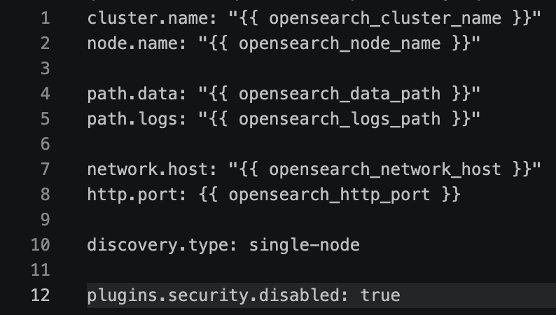

Отдельно подготовил шаблоны для Dashboards и системной настройки. Теперь конфиги хранятся вместе с ролью, и их не приходится каждый раз вручную копипастить на виртуалку. При выполнении плейбука Ansible сам создаёт нужные файлы по шаблонам и подставляет актуальные параметры.

## 7. Применение изменений через handlers

В `handlers/main.yml` добавил обработчики для перезапуска OpenSearch, OpenSearch Dashboards и применения настроек `sysctl`. В задачах использовал `notify`, чтобы вызывать нужный handler при изменении пакета или конфигурации. Например, если обновился шаблон `opensearch.yml`, сервису понадобится перезапуск, чтобы подхватить новые настройки. Просто так дёргать его на каждом прогоне смысла нет.

Для применения накопленных обработчиков использовал `flush_handlers`. При повторном запуске плейбука Ansible получил `changed=0`, то есть настройки уже совпадали с нужными и ничего лишнего менять или перезапускать не пришлось. Как раз этого и добивался: роль должна поддерживать нужное состояние системы, а не каждый раз переделывать всё с нуля.

## 8. Автоматический запуск после перезагрузки

В задачах настройки сервисов использовал модуль `systemd_service` с параметром `enabled: true`, чтобы OpenSearch и Dashboards были добавлены в автозагрузку. Для OpenSearch отдельно проверил состояние командами `systemctl is-active opensearch` и `systemctl is-enabled opensearch` через Ansible. Получил `active` и `enabled`: сервис запущен и включён в автозагрузку. Результат на скриншоте 14.

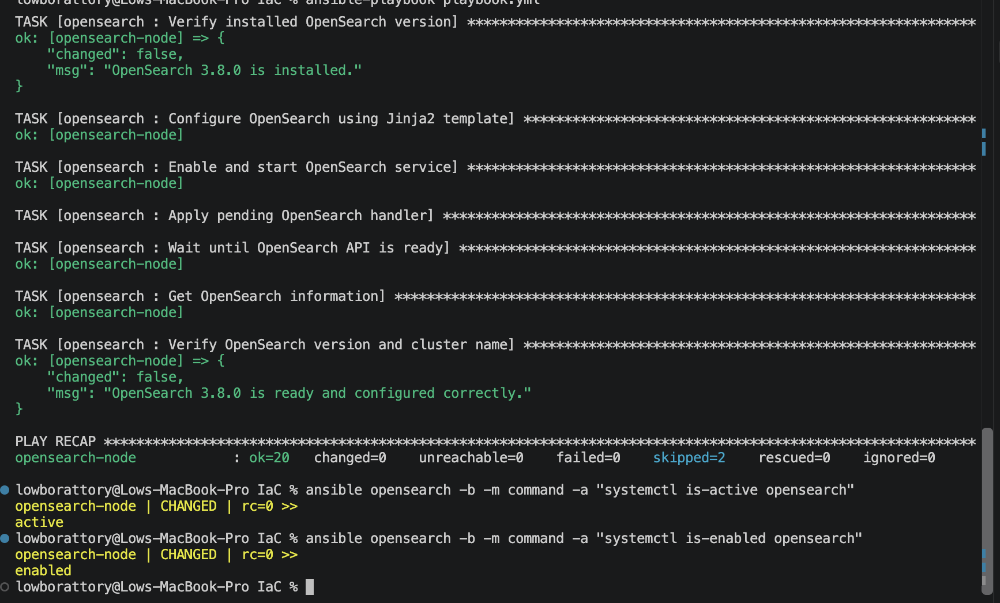

Команды проверки запускал через модуль `command`, поэтому в выводе Ansible появлялась пометка `CHANGED`. Сами команды при этом ничего не настраивали, а только проверяли состояние службы. Автозапуском дальше управляет `systemd`, вручную стартовать OpenSearch при обычной загрузке Ubuntu не понадобится.

## 9. Проверка готовности OpenSearch через API

Добавил ожидание готовности через модуль `uri`. Без него проверка сразу после старта могла бы отработать через пень колоду. Модуль обращается к API состояния кластера, ждёт HTTP `200` и статус `green` или `yellow`. Для проверки задал ограниченное число повторов и паузу между ними. Потом отдельным запросом получаю информацию OpenSearch и сверяю версию с именем кластера. Логика показана на скриншоте 13.

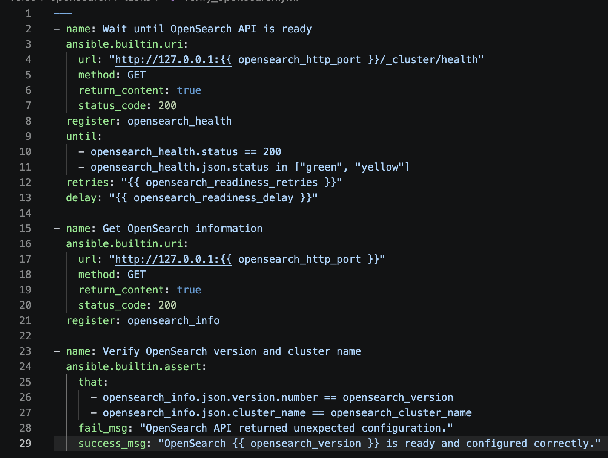

Проверки OpenSearch и Dashboards прошли успешно, оба сервиса отвечают на запросы. Дополнительно проверил состояние кластера командой `multipass exec iac-lab1 -- curl -sS 'http://127.0.0.1:9200/_cluster/health?pretty'`. Получил JSON со статусом `green`: один работающий узел, все 12 шардов активны, неназначенных шардов и задач в очереди нет. Значит, OpenSearch нормально поднялся и готов к работе. Результат на скриншоте 16.

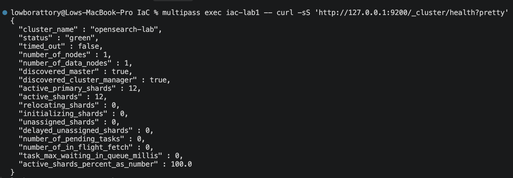

## 10. Окружение, команды запуска и итог проверки

Работал на Mac с macOS 26.6.2 и архитектурой arm64. Использовал Ansible Core 2.21.4 и Python 3.14.7. Окружение проверил командами `sw_vers`, `uname -m` и `ansible --version`. Перед деплоем проверил синтаксис через `ansible-playbook --syntax-check playbook.yml`, затем запустил плейбук. Во время проверки после правок столкнулся с `Permission denied (publickey)`: SSH-ключ был защищён passphrase, и Ansible не мог им воспользоваться. Поправил права доступа к ключу, добавил его в `ssh-agent`, после чего подключение заработало. Были ещё предупреждения Ansible, но запуск они не сломали.

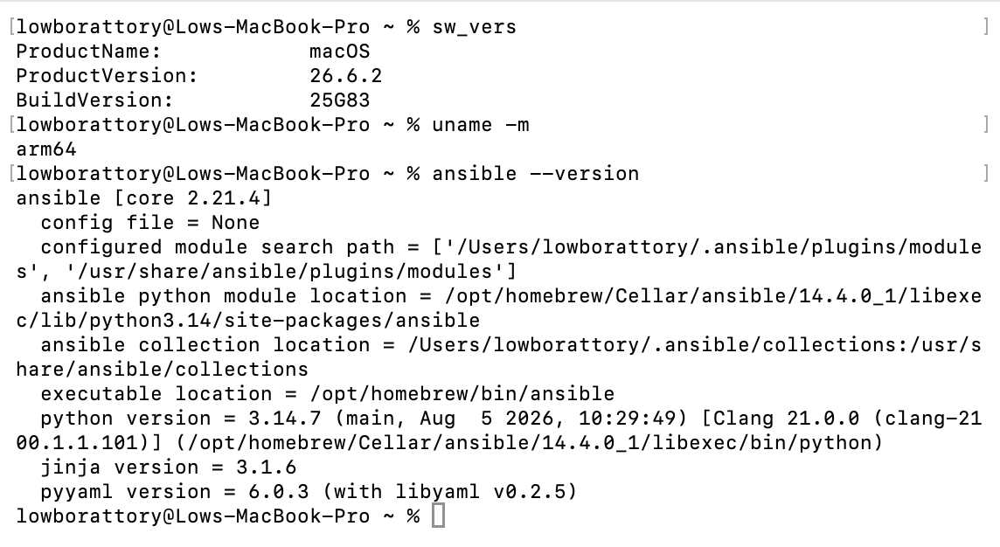

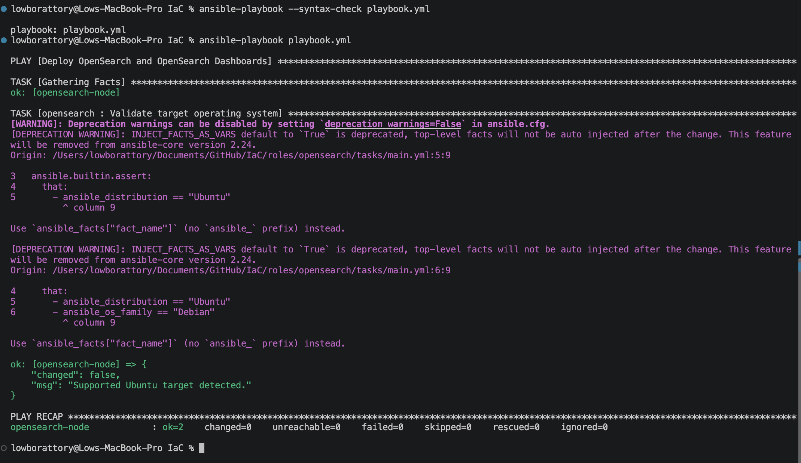

После настройки OpenSearch и Dashboards ещё раз запустил `ansible-playbook -i inventory.ini playbook.yml` для проверки идемпотентности. Получил `ok=29`, `changed=0`, `unreachable=0`, `failed=0`, `skipped=3`. То есть 29 задач отработали успешно, ошибок нет, повторно накатывать настройки не потребовалось. Лог сохранил в `artifacts/lab1/repeat.log`, итог запуска показан на скриншоте 15. В результате получил собственную Ansible-роль, которая разворачивает OpenSearch и Dashboards 3.8.0 на Ubuntu без Docker, применяет конфигурацию и проверяет работоспособность через API.

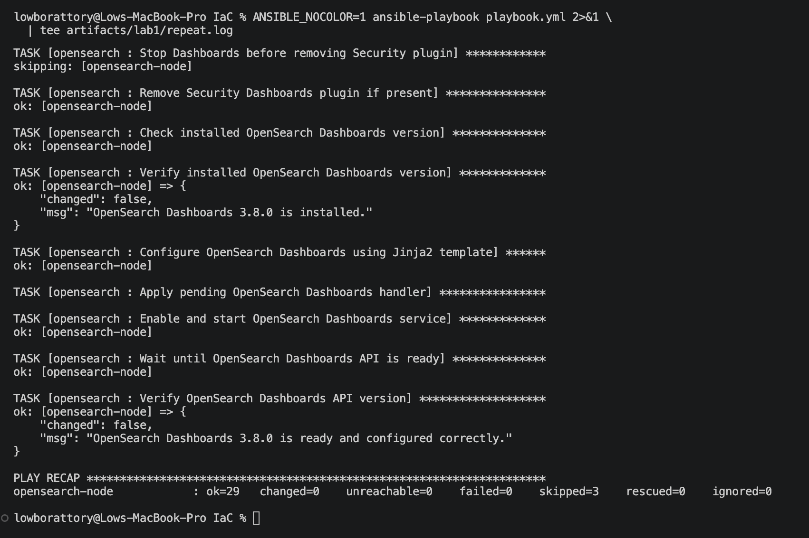
