# Лабораторная работа №2 — OpenSearch, роли и приключения с Molecule 🧪

Во второй лабе продолжил допиливать свою Ansible-роль `opensearch`. После первой работы у меня уже был стенд с OpenSearch и Dashboards 3.8.0 на Ubuntu в Multipass. Теперь добавил безопасность, разделил права пользователей и собрал автоматические проверки через Molecule. Всё делал в ветке `lab-2`, Ansible запускал с Mac в окружении `iac-molecule`.

Начал с паролей. Для них создал `group_vars/opensearch/vault.yml` через Ansible Vault. В задачах используются переменные, а сам файл хранится в зашифрованном виде. При запуске ввожу пароль Vault, после чего Ansible получает нужные значения. Проверил заголовок файла и прогнал syntax-check. На этом этапе всё выглядело спокойно. Даже подозрительно спокойно 🙂

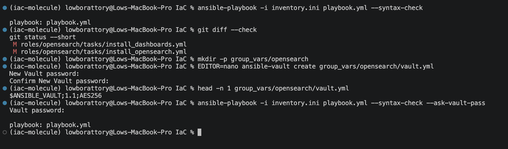

Перед включением Security посмотрел, какие инструменты и конфиги уже есть на виртуалке. Нашёл скрипт установки демонстрационной конфигурации и сделал резервную копию `opensearch.yml`. Всё-таки дальше предстояло менять авторизацию и сертификаты, поэтому возможность откатиться была очень кстати.

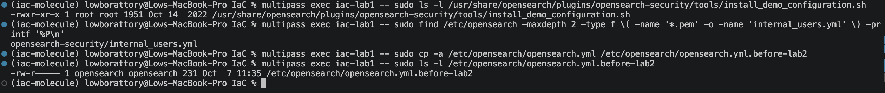

Первые приключения начались с учёткой admin. Запрос к API вернул HTTP 401. Пошёл разбираться с паролем, запустил `hash.sh` и получил следующий сюрприз: `java: command not found`. Получился небольшой квест внутри квеста.

Проверил встроенную Java в `/usr/share/opensearch/jdk` и передал этот путь через `OPENSEARCH_JAVA_HOME`. После этого генерация хеша заработала. Обновил запись в `internal_users.yml`, применил её через `securityadmin.sh` с сертификатом администратора и повторил запрос. В конце наконец появился HTTP 200. Этот момент особенно приятно было увидеть после нескольких заходов в терминал.

На скриншоте сохранил весь путь от ошибки до результата. Строку с хешем пароля закрыл перед публикацией.

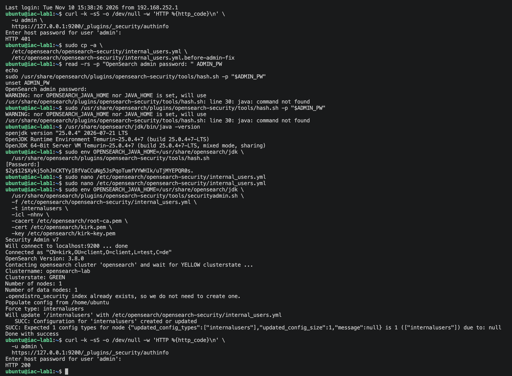

Затем отдельно проверил состояние Security-плагина. API вернул `status: UP` и `mode: strict`. Значит, можно двигаться дальше и настраивать ролевую модель.

Для локального учебного стенда использовал demo-сертификаты. API OpenSearch работает по HTTPS на локальном интерфейсе виртуалки, в проверках Ansible отключена проверка сертификата. Такой сетап позволил сосредоточиться на правах и автоматизации.

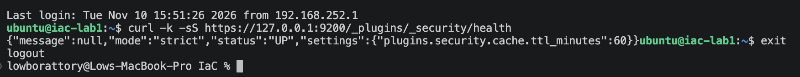

Следующим этапом подключил Dashboards к защищённому OpenSearch. В роли настроил служебную учётку `kibanaserver`, её пароль берётся из Vault. Для соединения Dashboards с OpenSearch добавил CA-сертификат и проверку сертификата сервера.

В браузере появилась форма авторизации. Теперь вход на стенд начинается с логина и пароля.

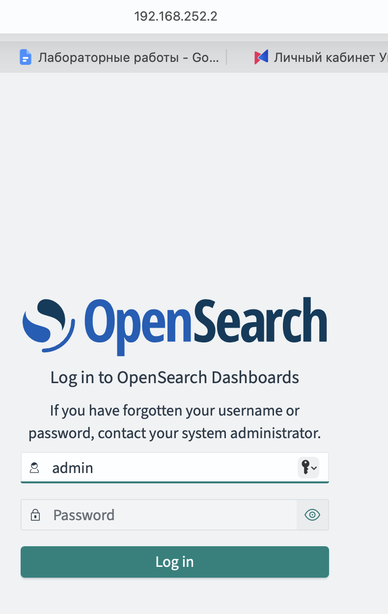

После входа открылся стартовый экран Dashboards. Веб-интерфейс ожил, можно было смотреть результаты настройки через браузер. Сам Dashboards на этом стенде доступен по HTTP на порту 5601.

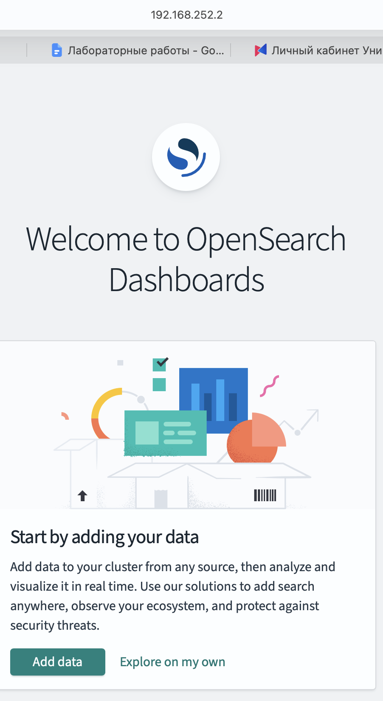

Дальше занялся ролями. Настройку вынес в отдельные Ansible-задачи, которые обращаются к Security REST API. Роль сначала читает текущее состояние, сравнивает его с нужным и при необходимости отправляет изменения.

Для записи создал `logs_writer`. Ему разрешена запись в data stream `logs`. Для чтения сделал `logs_reader` с доступом к индексам по шаблону `logs*`. Для администратора кластера добавил `cluster_admin`: получение информации о кластере и изменение его настроек, с пустым списком разрешений на индексы.

Потом создал три учётки: `logs_writer_user`, `logs_reader_user` и `cluster_admin_user`. Каждую связал со своей ролью через role mapping. Так в конфигурации сразу видно, кто за что отвечает. Writer отправляет логи, reader их читает, администратор занимается кластером.

После настройки Ansible проверил пользователей и mappings. Все три сопоставления прошли проверку.

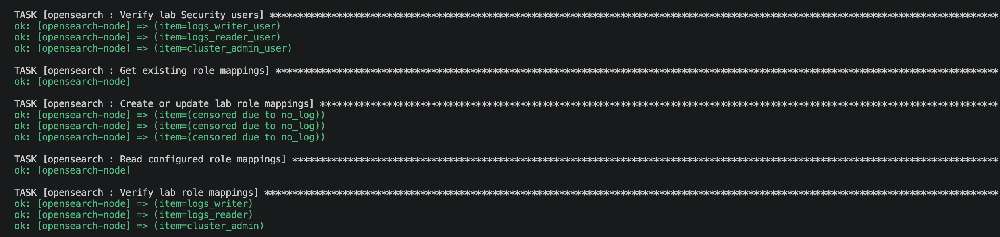

Теперь понадобилось место для логов. Добавил создание индексного шаблона `logs-template` и самого data stream `logs`. В шаблоне задал поле времени `@timestamp` типа `date` и поле `message` типа `text`. Для одного узла выбрал один primary shard и ноль реплик.

В задачах есть проверки существующего шаблона и потока. После применения роль ещё раз запрашивает их через API и проверяет основные параметры.

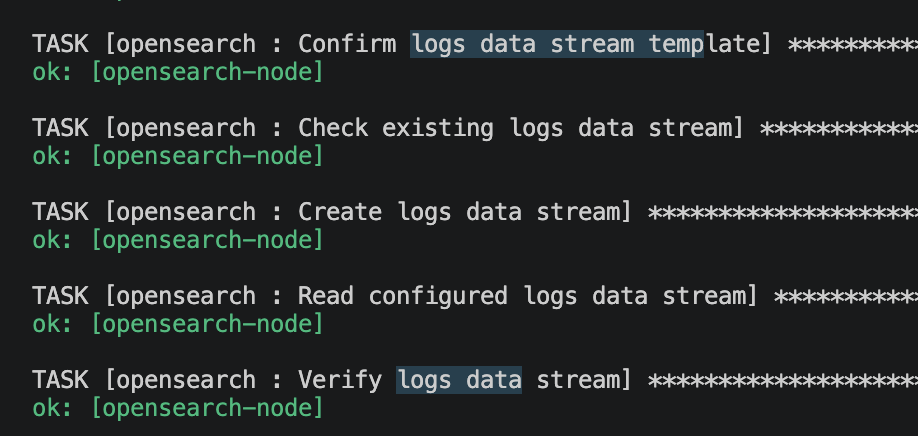

Посмотрел результат в Dashboards. У `logs-template` отображается тип Data streams, шаблон имени `logs` и приоритет 200. Ниже видны настройки шардов и оба поля. Удобно, когда написанный YAML можно потом сопоставить с тем, что реально получилось на стенде.

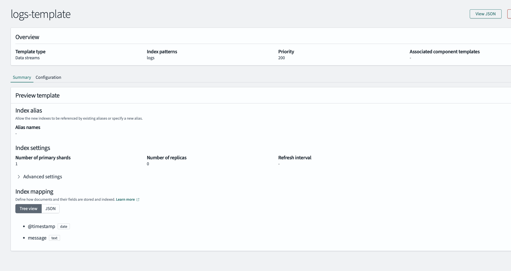

Сам поток `logs` появился со статусом Green. Внутри создан backing index `.ds-logs-000001`, поле времени выбрано правильно. На этом этапе документов ещё было ноль. Наполнение оставил следующим участникам вечеринки — автоматическим тестам.

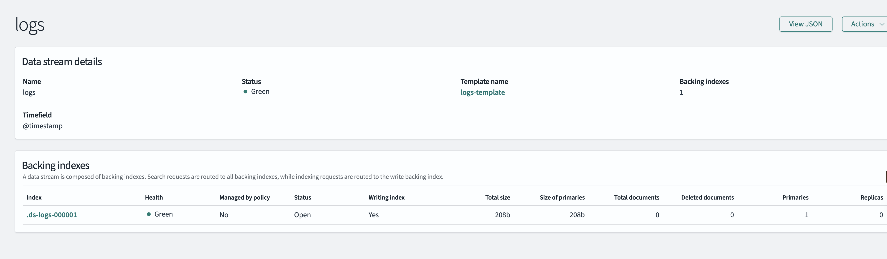

После настройки перешёл к Molecule. Создал сценарий `default`, а проверки разложил по файлам `verify_00.yml` — `verify_03.yml`. Общий `verify.yml` запускает их последовательно. Поэтому в выводе Molecule фигурирует один сценарий, внутри которого выполняются четыре тестовых случая из задания.

Molecule работает с уже поднятой виртуалкой через существующий inventory. Полный прогон включает проверку синтаксиса, применение роли, проверку идемпотентности и тесты.

В сценарии 0 собрал проверку готовности стенда. Проверяю службы OpenSearch и Dashboards, версию OpenSearch, состояние кластера, количество узлов, Security-плагин, наличие `logs` и ответ веб-интерфейса. Дополнительно проверяю, что запрос к корневому API без авторизации получает HTTP 401.

Получился небольшой чек-ап перед проверкой прав. Первый вариант этого набора успешно прошёл.

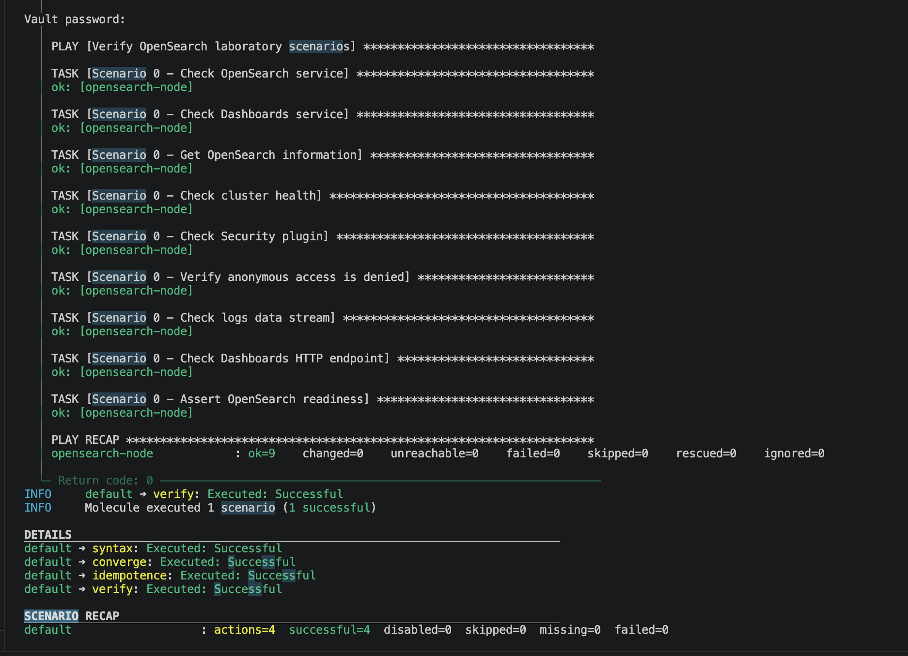

В сценарии 1 вошёл под writer и записал документ в `logs`. Проверка ожидает HTTP 201, результат `created` и ID нового документа. Затем под той же учёткой выполняется поиск, для которого ожидается HTTP 403.

Обе проверки прошли. Тут пришлось привыкнуть к забавной особенности тестирования прав: отказ в доступе тоже может быть хорошей новостью. В данном случае именно такой ответ и нужен 🔐

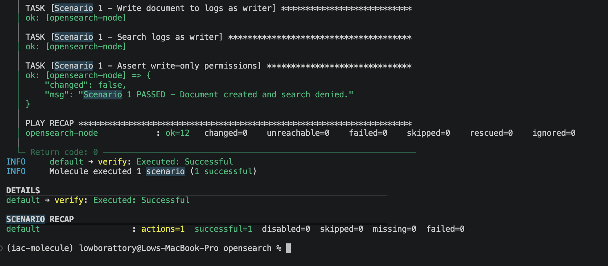

В сценарии 2 подключился под reader и нашёл документ, который только что записал writer. Поиск идёт по его ID, дополнительно проверяется содержимое сообщения.

Потом попробовал записать новый документ и удалить существующий. Обе операции должны вернуть HTTP 403. Для проверки доступа за пределами `logs*` создал отдельный временный индекс, положил туда документ и попробовал прочитать его под reader. Здесь тоже получил ожидаемый запрет. Очистку временного индекса вынес в блок `always`.

Первая версия сценария прошла, но к формулировке задания я ещё вернулся во время финальной проверки.

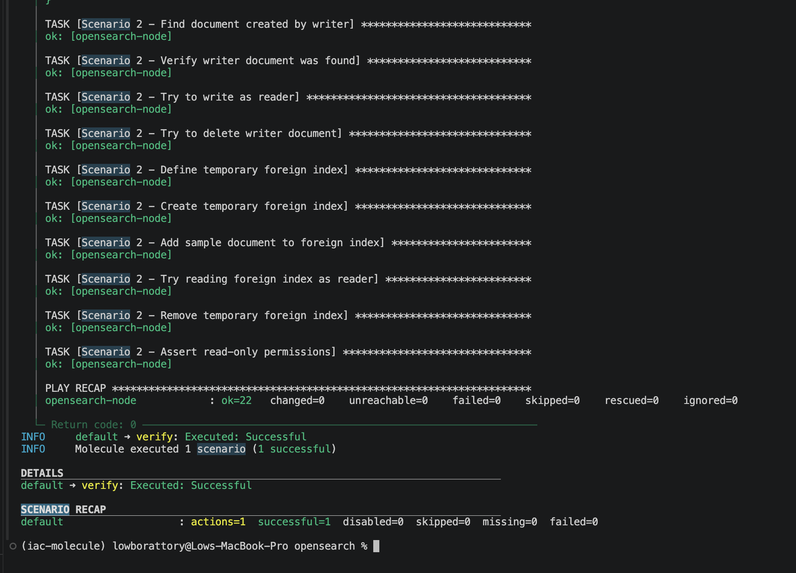

В сценарии 3 проверил учётку администратора кластера. Под ней запросил настройки, состояние кластера и версию OpenSearch. Затем попробовал прочитать и записать данные в `logs`.

Информация о кластере успешно возвращалась, а операции с данными получили HTTP 403. Проверки закрепил через `assert`, чтобы результат определялся автоматически.

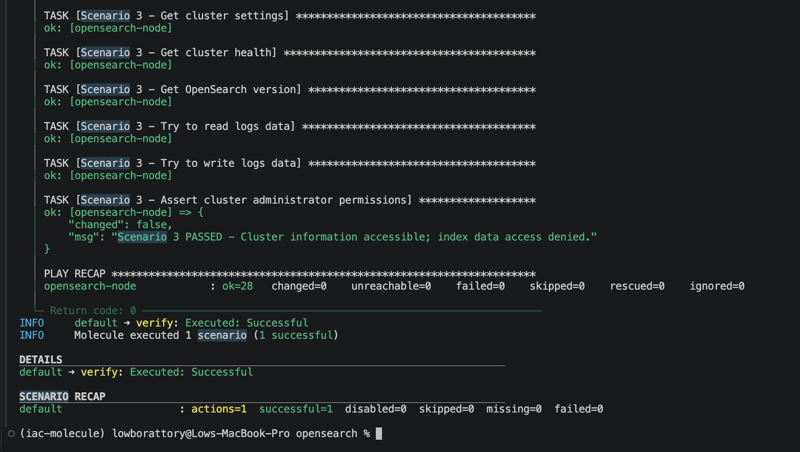

Во время проверки перед отчётом нашёл упущение в сценарии reader. В методичке требовалась попытка удалить индекс целиком, а у меня проверялось удаление документа. Похожая формулировка, совсем другой API-запрос. Вот тут внимательное чтение задания пригодилось второй раз.

Добавил отдельный временный индекс `logs-molecule-delete-*`. Admin создаёт его, reader пробует удалить и получает HTTP 403, затем admin выполняет очистку. Так проверка проходит на специально подготовленном объекте. Старую проверку удаления документа тоже оставил.

Дополненный сценарий успешно отработал. На скриншоте видно два изменения: создание временного индекса и его последующее удаление администратором.

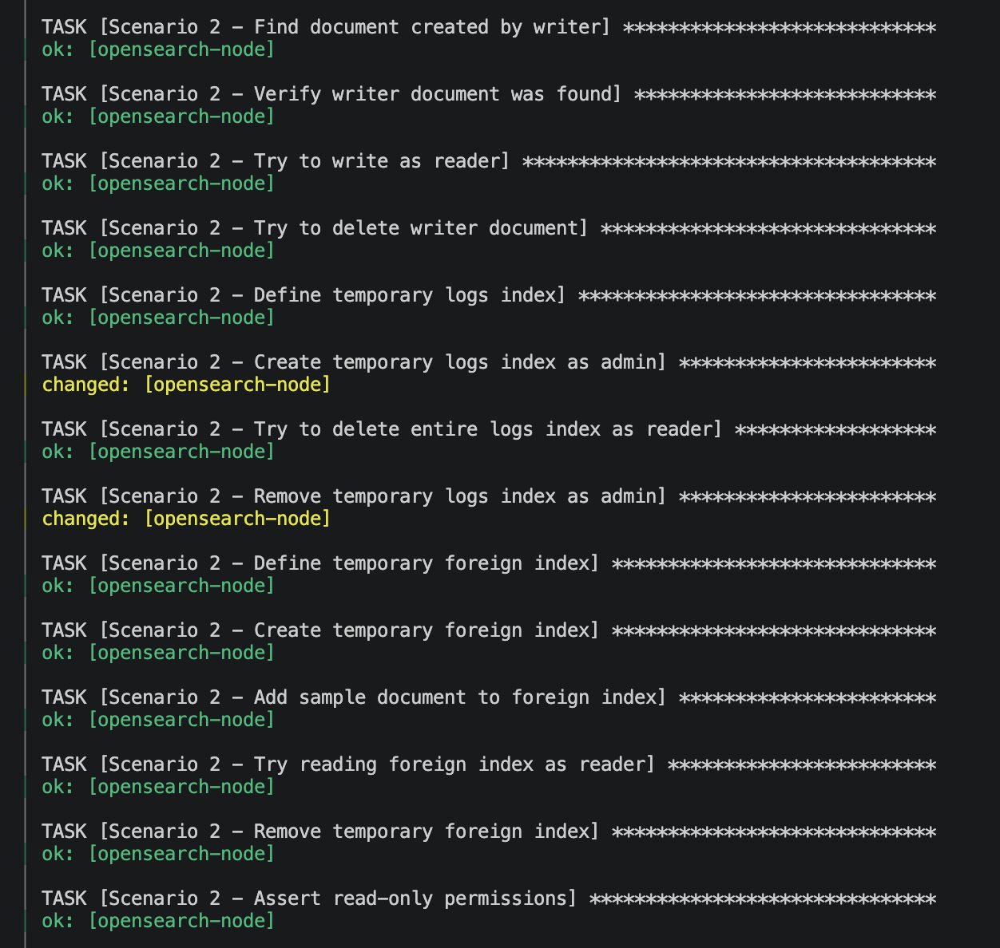

Заодно ещё раз прошёлся по обработке секретов. Добавил `no_log: true` в итоговые проверки пользователей и mappings, потому что их циклы получают словарь с паролями. Вывод задач тоже оказался частью работы с секретами.

А самый интересный баг вылез на идемпотентности. У изменяющих API-запросов добавил явный `changed_when: true`, сохранив условия, которые решают, когда требуется обновление. После этого Molecule поймал постоянное обновление `logs-template`.

Для диагностики временно вывел текущий и желаемый шаблоны. Оказалось, OpenSearch возвращает настройки шардов внутри `settings.index`, причём значения приходят строками: `"1"` и `"0"`. В моём определении они лежали непосредственно в `settings` и были числами.

По смыслу настройки совпадали, а сравнение структур каждый раз находило разницу. Ansible добросовестно отправлял шаблон заново. YAML устроил бюрократию на ровном месте 😅

Привёл желаемое определение к формату ответа API: добавил вложенность `index` и строковые значения. Временный диагностический вывод удалил и снова запустил полный тест.

Для запуска использовал окружение `iac-molecule`, а из папки `roles/opensearch` выполнял `molecule test -s default`. При запросе вводил пароль Vault.

Последний прогон завершился успешно: все четыре этапа получили `Successful`, в итоговой сводке `successful=4`, `missing=0` и `failed=0`. Проверка идемпотентности тоже прошла. В конце этапа `verify` осталось ожидаемое `changed=2` от создания и удаления временного индекса.

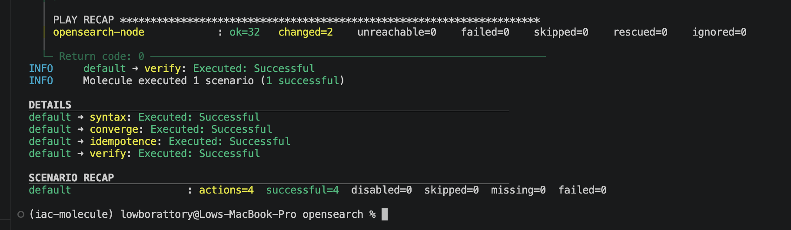

В этой лабе больше всего времени ушло на детали вокруг безопасности и проверки состояния. Пришлось разобраться с доступом admin, найти Java для служебных скриптов, внимательно разделить операции с документами и индексами, а потом ещё подружить формат ответа OpenSearch с Ansible.

Зато теперь у роли есть автоматическая настройка пользователей и прав, а у меня — повторяемый набор проверок. После очередной правки можно запустить Molecule и увидеть, как ведут себя реальные учётки на стенде. Такой результат уже приятно коммитить 🚀